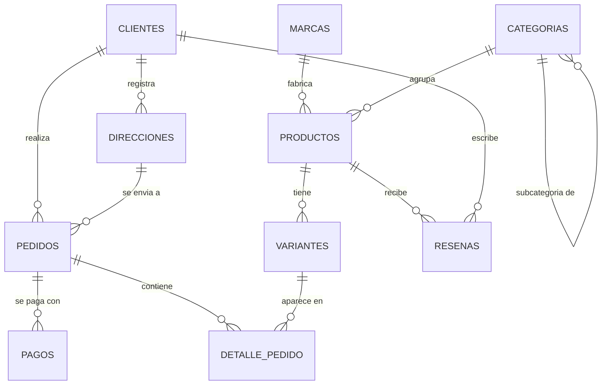

# Modelos del proyecto

## Modelo relacional (SQL Server · `TiendaRopa`)

## Modelo documental (MongoDB · `TiendaRopa`)

| Colección | Documento | Embebido | Referenciado | Justificación |
|---|---|---|---|---|
| `productos` | producto | `marca`, `variantes[]` | `categoria_id` | Variantes pocas y leídas con el producto; marca duplicada (patrón de referencia extendida) |
| `categorias` | categoría | — | `categoria_padre_id` | Vida propia, usada por muchos productos |
| `clientes` | cliente | `direcciones[]` | — | Pocas direcciones, leídas en el checkout |
| `pedidos` | pedido | `items[]`, `pagos[]`, `envio` | `cliente_id` | Snapshots de precio y dirección; líneas sin vida fuera del pedido |
| `resenas` | reseña | — | `producto_id`, `cliente_id` | Crecimiento ilimitado; evita el límite de 16 MB por documento |

Referencia: [MongoDB Docs · Data Modeling](https://www.mongodb.com/docs/manual/data-modeling/).
