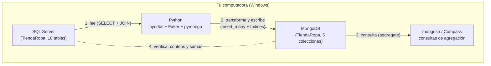
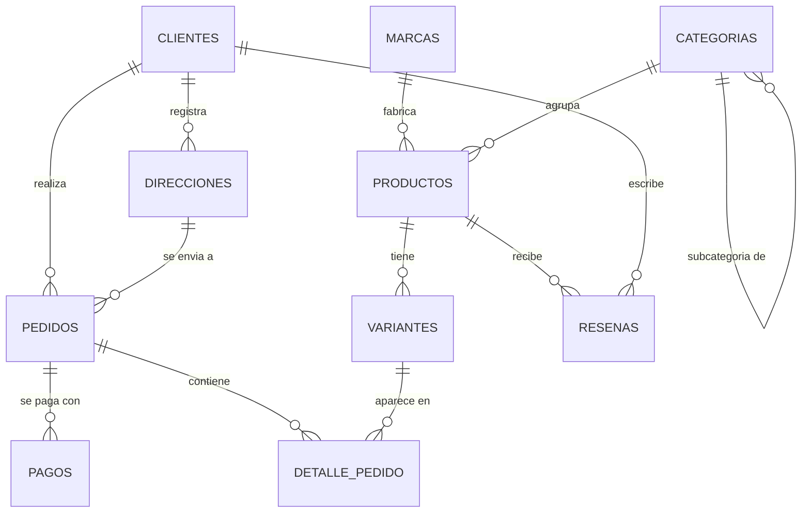
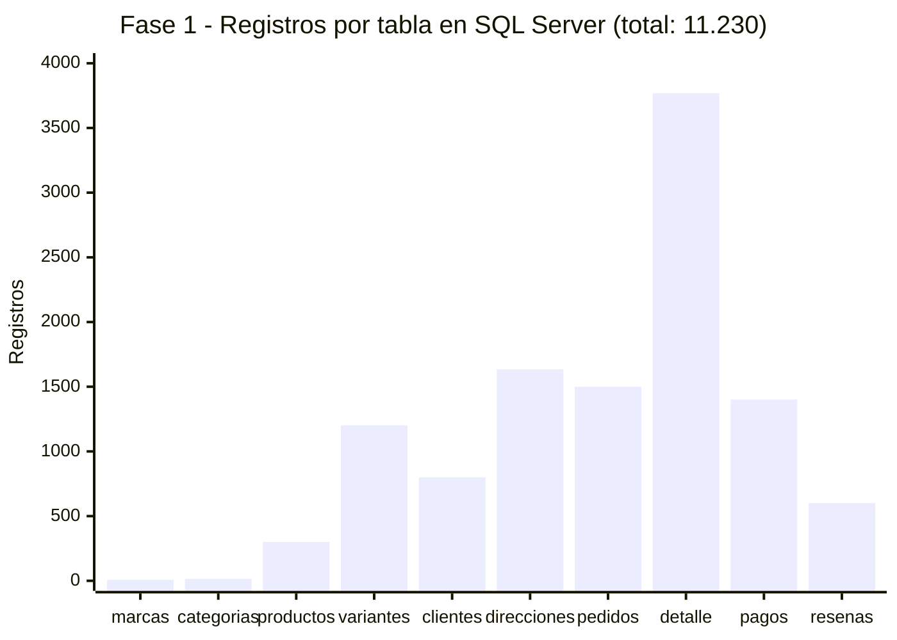
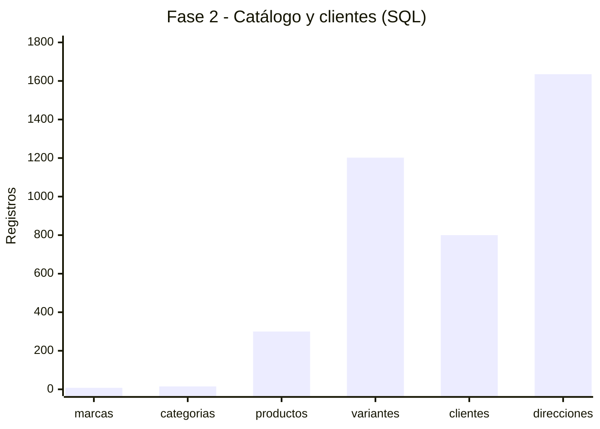
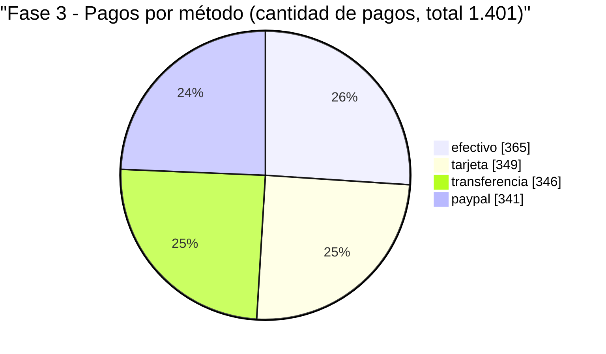
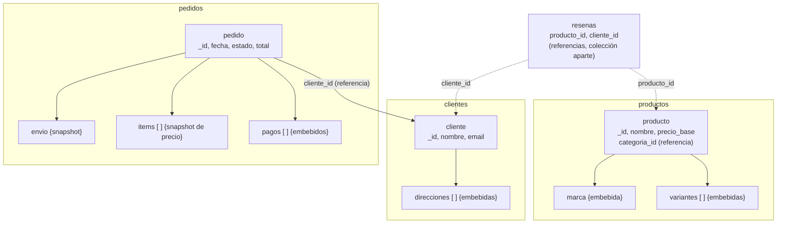
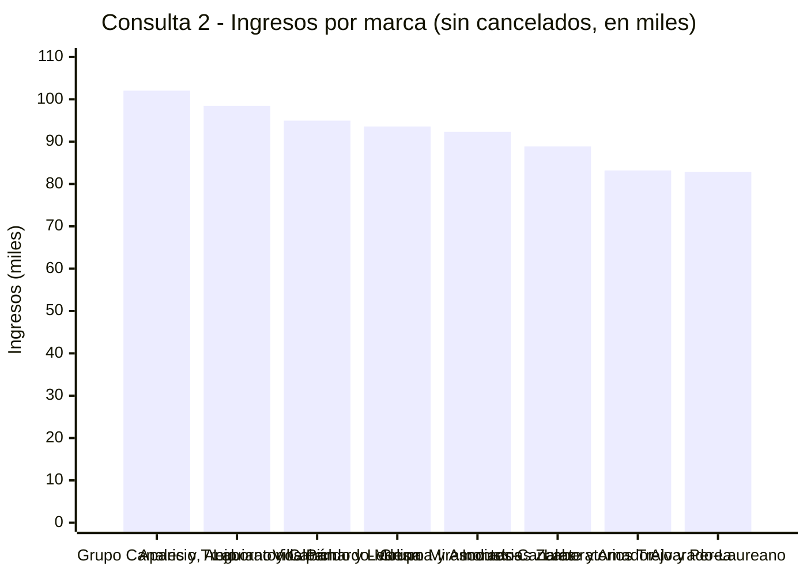
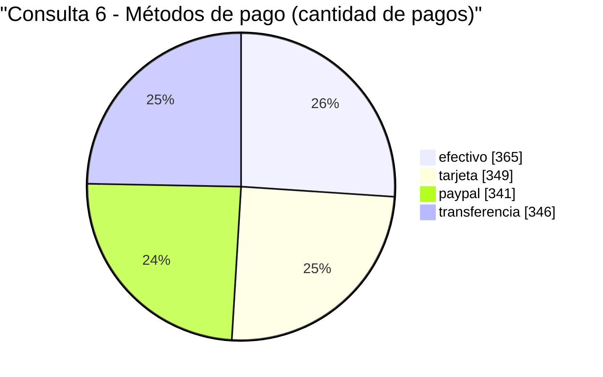

# Taller 3 · Migración de una tienda de ropa: SQL Server → MongoDB

> **Qué es esta nota:** tu guion de exposición. Tiene el qué, el cómo, el porqué, las pruebas que hicimos, los errores que tuvimos y cómo se corrigieron, y las preguntas que te pueden hacer.

> **Materia:** Bases de datos II · Profesor: Juan Carlos Gómez · Trabajo individual.

---

## 0. Antes de exponer: lista de apps y pestañas

Abre esto la noche anterior y vuelve a comprobarlo 15 minutos antes.

| # | App / pestaña | Qué mostrar | Verificación previa |
|---|---|---|---|
| 1 | **Obsidian** (esta nota, en lectura y pantalla completa) | Guion, gráficas, evidencias | Abre el mapa de la nota y revisa que las imágenes carguen |
| 2 | **SQL Server Management Studio (SSMS)** | Pestaña 1: `01_schema.sql`. Pestaña 2: consultas de verificación. Pestaña 3: `SELECT SUM(total)...` | Conéctate a `localhost` y revisa que `TiendaRopa` aparezca con sus 10 tablas |
| 3 | **MongoDB Compass** | Base `TiendaRopa` con sus 5 colecciones; abre un documento de `pedidos` | Muestra que el servicio de MongoDB esté corriendo |
| 4 | **mongosh** (terminal) | `use TiendaRopa` y una consulta de conteo ejecutada | Escribe `show collections` para confirmar |
| 5 | **VS Code** (o el editor que uses) | `migracion_mongo.py`, `poblar_operaciones.py`, `07_consultas.js` | Cada archivo abierto en su pestaña |
| 6 | **Terminal de Windows** en la carpeta de los scripts | Comando `python migracion_mongo.py` listo (sin ejecutar) | Revisa que `python` y `pyodbc` respondan |
| 7 | **Navegador** con pestañas de documentación | MongoDB Docs: [Data Modeling](https://www.mongodb.com/docs/manual/data-modeling/), [$lookup](https://www.mongodb.com/docs/manual/reference/operator/aggregation/lookup/), [$unwind](https://www.mongodb.com/docs/manual/reference/operator/aggregation/unwind/), [Decimal128](https://www.mongodb.com/docs/manual/reference/bson-types/#decimal128). Microsoft Learn: [GO](https://learn.microsoft.com/es-es/sql/t-sql/language-elements/sql-server-utilities-statements-go), [OUTPUT](https://learn.microsoft.com/es-es/sql/t-sql/queries/output-clause-transact-sql) | Pestañas listas, sin login pendiente |
| 8 | **PDF de la consigna** (Taller 3) | Para leer los requisitos en voz alta si te los preguntan | Abierto en la página 2 |
| 9 | **Repositorio Git** (ver sección 1, pendiente) | Enlace al repositorio con los scripts | Ver pendiente E13 |

**Plan B si algo falla en vivo:** no ejecutes nada nuevo. Muestra las evidencias de esta nota (capturas), que ya tienen los resultados.

---

## 1. Lo que pidió el profesor vs. lo que cumplimos

| Requisito de la consigna | Dónde lo demostramos | Estado |
|---|---|---|
| Base relacional en SQL Server con **10 entidades** | Sección 3 · Paso 1 | ✅ 10 tablas |
| **Más de 5.000 registros** | Fase 1 y evidencia E03 | ✅ 11.230 registros |
| Migración con **Python** (pyodbc → pymongo) | Fase 4 | ✅ |
| No copiar tabla por tabla: **decidir** el modelo documental | Sección 5 | ✅ 5 decisiones justificadas |
| **Embedding** y **Referencing**, arrays de documentos, relaciones entre colecciones | Sección 5 | ✅ |
| Explicar cómo se hizo la transformación y cómo se verificó | Fases 4 y 5 | ✅ |
| **6 a 8 consultas** con Aggregation Pipeline, `$lookup`, `$match`, `$project` | Fase 5 | ✅ 7 consultas |
| Consultas con **múltiples `$lookup`** | Fase 5 | ⚠️ **Parcial:** cada consulta tiene un solo `$lookup`. Ver error E12 |
| Justificar cada consulta: qué busca, por qué importa, qué decisión apoya | Fase 5 | ✅ |
| Verificación: conteos, referencias, embebidos y comparación con SQL | Fase 4 | ✅ |
| Entregable: **repositorio Git** con scripts, evidencias y presentación | — | ❌ **Pendiente.** Ver E13 |
| **Sustentación** en vivo | Esta nota | ✅ preparada |

---

## 2. Arquitectura del sistema

**En una frase:** SQL Server guarda la información ordenada en tablas; Python la lee, la reorganiza en documentos y la guarda en MongoDB; después MongoDB responde preguntas de negocio con consultas de agregación.

---

## 3. El modelo relacional (la tienda)

Tienda de ropa al estilo Nike: una **marca** tiene **productos**; cada producto tiene **variantes** (talla + color, cada una con su SKU y stock).

| Tabla | Qué guarda | Por qué existe |
|---|---|---|
| `marcas` | Nombre y país | Una marca vende muchos productos: no repetir su nombre en cada producto |
| `categorias` | Jerarquía (Ropa › Calzado › Running) | Auto-relación con `categoria_padre_id` |
| `productos` | Nombre, descripción, precio base | El "modelo" de lo que se vende |
| `variantes` | SKU, talla, color, stock | El inventario se controla por talla y color |
| `clientes` | Nombre, email único, teléfono | Personas que compran |
| `direcciones` | Ciudad, calle, código postal | Un cliente tiene varias direcciones |
| `pedidos` | Cliente, dirección, fecha, estado, total | Cabecera de la compra |
| `detalle_pedido` | Variante, cantidad, precio al momento de compra | Relación N:M entre pedidos y variantes |
| `pagos` | Método, monto, fecha | Un pedido puede tener varios pagos |
| `resenas` | Calificación 1–5, comentario | Un cliente reseña cada producto una sola vez |

---

## 4. Fase por fase: qué, cómo, por qué, verificación y errores

Cada fase tiene: **qué hicimos**, **cómo**, **por qué**, **cómo lo comprobamos** (evidencia + gráfica) y **errores**.

### Fase 1 · Diseño y esquema en SQL Server (Paso 1)

- **Qué hicimos:** creamos la base `TiendaRopa` con 10 tablas, claves foráneas y restricciones.
- **Cómo:** un script SQL (`01_schema.sql`) ejecutado en SSMS con F5. Código: 01 - Esquema SQL · Explicación: 01 - Esquema SQL (breve).
- **Por qué:** SQL Server garantiza la integridad: no puede existir un pedido sin cliente ni una variante sin producto.
- **Verificación:** consulta de `INFORMATION_SCHEMA.TABLES`, debe listar las 10 tablas.

**Estado actual de la fase 1 (SQL):**

### Fase 2 · Catálogo, clientes y direcciones (Pasos 2 y 3)

- **Qué hicimos:** generamos 8 marcas, 15 categorías, 300 productos, 1.202 variantes, 800 clientes y 1.635 direcciones.
- **Cómo:** scripts de Python con `pyodbc` y Faker en español de México. Inserción por lotes con `executemany`. Códigos: 03 - Clientes y direcciones y el Paso 2 en 02 - Catalogo (pendiente).
- **Por qué:** datos realistas y reproducibles (semilla 42) para tener más de 5.000 registros con relaciones coherentes.
- **Verificación:** conteos esperados, cero productos sin variantes, cero SKU duplicados, cero clientes sin dirección principal y cero clientes con dos principales.

**Evidencias:**

**Estado actual de la fase 2 (SQL):**

### Fase 3 · Pedidos, detalle, pagos y reseñas (Paso 4) y verificación relacional

- **Qué hicimos:** 1.500 pedidos con 3.769 líneas, 1.401 pagos y 600 reseñas. Total: 11.230 registros.
- **Cómo:** `poblar_operaciones.py`. Cada pedido usa una dirección del mismo cliente; el precio se copia en cada línea (snapshot); los pagos solo existen para pedidos pagados, enviados o entregados. Código: 04 - Pedidos, detalle, pagos y resenas · Explicación: 04 - Pedidos, detalle, pagos y resenas (breve).
- **Por qué:** así se puede demostrar que la base es coherente antes de migrar.
- **Verificación:** total = suma de líneas (0 diferencias), dirección del cliente correcta (0 casos), reseñas solo de productos comprados (0 casos).

**Evidencia:**

**Estado actual de la fase 3 (SQL):**

### Fase 4 · Migración a MongoDB (Paso 6)

- **Qué hicimos:** pasamos los datos de 10 tablas a 5 colecciones con documentos anidados.
- **Cómo:** `migracion_mongo.py`. Lee cada tabla una vez, agrupa los hijos por padre en diccionarios, construye los documentos y los inserta por lotes de 500. Código: 06 - Migracion a MongoDB · Explicación: 06 - Migracion a MongoDB (breve).
- **Decisiones técnicas:**
  - **IDs de SQL como `_id`:** las referencias siguen siendo enteros fáciles de comprobar.
  - **`Decimal128` para dinero:** evita errores de redondeo que sí ocurren con `float`.
  - **`convertir_fecha()`:** BSON solo acepta `datetime`, no `date`.
- **Verificación:** conteos y sumas iguales entre SQL y Mongo.

**Evidencias:**

**Tabla de verificación SQL vs MongoDB:**

| Dato | SQL Server | MongoDB | Resultado |
|---|---|---|---|
| productos | 300 | 300 | ✅ |
| categorias | 15 | 15 | ✅ |
| clientes | 800 | 800 | ✅ |
| pedidos | 1.500 | 1.500 | ✅ |
| resenas | 600 | 600 | ✅ |
| variantes (embebidas en productos) | 1.202 | 1.202 | ✅ |
| direcciones (embebidas en clientes) | 1.635 | 1.635 | ✅ |
| items (embebidos en pedidos) | 3.769 | 3.769 | ✅ |
| pagos (embebidos en pedidos) | 1.401 | 1.401 | ✅ |
| **suma de totales de pedidos** | **756.367,39** | **756.367,39** | ✅ al centavo |

**Estado actual de la fase 4 (SQL vs Mongo):**

```mermaid
xychart-beta
    title "Fase 4 - SQL vs MongoDB (las barras deben ser iguales)"
    x-axis ["productos", "clientes", "pedidos", "resenas", "variantes", "direcciones", "items", "pagos"]
    y-axis "Documentos o registros" 0 --> 4000
    bar [300, 800, 1500, 600, 1202, 1635, 3769, 1401]
    bar [300, 800, 1500, 600, 1202, 1635, 3769, 1401]
```

> Las dos series son idénticas: **esa es la prueba**. Si una barra de Mongo fuera distinta, habría pérdida de datos.

**Arquitectura de datos en MongoDB:**

### Fase 5 · Consultas de agregación (Paso 7)

- **Qué hicimos:** 7 consultas de negocio más una verificación numérica.
- **Cómo:** `07_consultas.js` en mongosh. Cada consulta responde una pregunta concreta y apoya una decisión. Código: 07 - Consultas de agregacion · Explicación: 07 - Consultas de agregacion (breve).
- **Por qué:** una base de datos sirve si ayuda a decidir.

| # | Pregunta de negocio | Decisión que apoya | Operadores clave |
|---|---|---|---|
| 1 | ¿Qué variantes (talla y color) se venden más? | Cuánto producir de cada talla y color | `$unwind`, `$group`, `$sort`, `$limit` |
| 2 | ¿Qué marcas generan más ingresos? | Priorizar marcas en compras y promociones | `$lookup` con pipeline + `$expr` + `$in` |
| 3 | ¿Quiénes son los clientes más valiosos? | Programas de lealtad | `$group`, `$lookup` |
| 4 | ¿Cómo evolucionan las ventas por mes? | Cuándo reforzar inventario o campañas | `$year`, `$month`, `$group` |
| 5 | ¿Qué productos tienen peor calificación? | Revisar proveedor o retirar el producto | `$avg`, `$match`, `$lookup` |
| 6 | ¿Qué métodos de pago usan los clientes? | Qué pasarelas contratar | `$unwind` sobre `pagos` |
| 7 | ¿Qué tallas y colores están por agotarse? | Qué reabastecer primero | `$unwind`, `$match`, `$lookup` |

**Evidencias:**

**Estado actual de la fase 5 (resultados):**

**Cuadratura de la fase 5:**
- Suma de las 8 marcas (Consulta 2) = **736.180,65**, igual al ingreso total de la verificación. ✅
- Suma de los 4 métodos de pago (Consulta 6) = **1.401 pagos**, igual al total de pagos embebidos. ✅
- Unidades vendidas (pedidos no cancelados) = **7.326** en SQL y en Mongo. ✅
- Total de pagos = **703.837,34** en SQL y en Mongo. ✅

---

## 5. Decisiones de modelado: Embedding vs Referencing

| Colección | Decisión | Justificación técnica (para defender) |
|---|---|---|
| `productos` | **Embedding** de `variantes` y `marca` | **Acceso conjunto:** las variantes son pocas (3–5) y siempre se leen con el producto. Se evitan `$lookup`. La marca se duplica deliberadamente (**patrón de referencia extendida**): se lee el producto en una sola operación. |
| `categorias` | **Referencing** desde productos | Tiene vida propia y se usa en muchos productos. |
| `clientes` | **Embedding** de `direcciones` | Son pocas (1–3) y el checkout siempre necesita la dirección junto al cliente. |
| `pedidos` | **Embedding** de `items`, `pagos` y `envio` | Las líneas y pagos no existen fuera del pedido. La **dirección y el precio son snapshots**: si el catálogo cambia mañana, el recibo de ayer no cambia. |
| `resenas` | **Referencing** (`producto_id`, `cliente_id`) | **Crecimiento ilimitado:** cualquier producto puede acumular miles de reseñas. Embeberlas haría que el documento superara el **límite de 16 MB**. |

**Regla para la pregunta del profesor:** *"Los datos que se consultan juntos se guardan juntos. Los datos con vida propia o crecimiento ilimitado se separan y se referencian."*

**Referencias:** [MongoDB Docs · Data Modeling](https://www.mongodb.com/docs/manual/data-modeling/).

---

## 6. Errores reales y cómo los corregimos

> Mostrar errores no es un fallo: demuestra que probamos, detectamos y corregimos. Explícalos en este orden: **qué pasó → por qué pasó → cómo se corrigió.**

| # | Fase | Error | Por qué pasó | Cómo se corrigió | Estado |
|---|---|---|---|---|---|
| E01 | 1 | Los IDs empezaban en 0 en lugar de 1 | `DBCC CHECKIDENT ... RESEED, 0` deja el contador en 0 y el siguiente valor es 1; un valor incorrecto de reseteo desplazaba la numeración | Se ajustó el comando de reseteo para que los IDs empiecen en 1 | ✅ Corregido |
| E02 | 2 | `FOREIGN KEY constraint`: se intentó crear direcciones antes que los clientes | El script insertaba direcciones con IDs que aún no existían | Insertar clientes, leer sus IDs reales y después insertar direcciones | ✅ Corregido |
| E03 | 3 | `5 parameter markers, but 4 parameters were supplied` | El `INSERT` de pedidos tenía 5 `?` y la tupla solo traía 4 valores (faltaba el estado) | Se completó la tupla con los 5 valores | ✅ Corregido |
| E04 | 3 | `NoneType`: no se podía leer el ID del pedido recién creado | Preguntar el ID en una segunda instrucción no siempre devuelve el mismo registro | `OUTPUT INSERTED.pedido_id` devuelve el ID en la misma instrucción | ✅ Corregido |
| E05 | 4 | Error de sintaxis en la primera línea del script de migración | Se escribió `pyodbc` en lugar de `import pyodbc` | Se corrigió la línea de importación | ✅ Corregido |
| E06 | 4 | MongoDB rechazó las fechas | `pyodbc` devuelve `date` (solo día) para columnas DATE; BSON exige `datetime` | Función `convertir_fecha()` que convierte `date` a `datetime` | ✅ Corregido |
| E07 | 5 | La Consulta 2 no podía obtener la marca de cada venta | El pedido guarda `sku` y `variante_id` dentro del arreglo `items`, pero la variante está embebida dentro de `productos` (un arreglo). Un `$lookup` simple no puede hacer match contra un campo dentro de un arreglo | `$lookup` con `let` + `pipeline` + `$expr` + `$in` dentro de `productos.variantes` | ✅ Corregido |
| E08 | 5 | Riesgo: la Consulta 1 podría mezclar productos con nombres repetidos | Agrupar por nombre suma productos distintos si el nombre coincide | Agrupar por variante (SKU + producto + talla + color). Comprobación de duplicados incluida en el script | ✅ Corregido · ⏳ resultado de la comprobación pendiente |
| E09 | 5 | Las consultas de ventas incluían pedidos cancelados | Falta de filtro en el pipeline | `$match: { estado: { $ne: "cancelado" } }` en todas las consultas de ventas | ✅ Corregido |
| E10 | 3 | **Reseñas de compras canceladas.** El generador puede crear reseñas de productos que el cliente compró en un pedido **cancelado** | En `poblar_pedidos()` se agregan `compras_historicas` **sin revisar el estado**, y la muestra de reseñas sale de esa lista | **Corrección propuesta:** solo agregar a `compras_historicas` cuando `estado != 'cancelado'`. Luego re-ejecutar el Paso 4, la migración y las verificaciones. La verificación "reseña sin compra" tampoco filtraba cancelados, por eso no lo detectó | ⚠️ **Abierto** (ver nota de cierre) |
| E11 | 3 | Dinero calculado con `float` en el generador | Se usó `CAST(... AS FLOAT)` para los precios; `float` no es exacto para dinero | Las sumas cuadraron con la base, pero lo correcto es `Decimal` en Python. Se explica como **mejora identificada** | ⚠️ **Mejora pendiente** (no afectó las cifras verificadas) |
| E12 | 5 | La consigna pide **múltiples `$lookup`** y cada consulta tiene solo uno | Diseño inicial enfocado en una relación por consulta | Agregar una consulta con dos `$lookup` encadenados (ventas por categoría: `productos` → `categorias`) | ⚠️ **Abierto** |
| E13 | — | **Falta el repositorio Git** que pide el Campus Virtual | No se creó el repo antes | Crear el repo, subir scripts, evidencias y esta presentación | ⚠️ **Abierto** |

**Dato corregido:** la base tiene **10** tablas, no 14. Si algún resumen de otra herramienta dice 14, está equivocado.

---

## 7. Preguntas probables del profesor (con respuesta)

**1. ¿Por qué no simplemente copiaste las tablas como colecciones?**
Porque MongoDB no está pensado para joins. Copiar tabla por tabla obliga a usar `$lookup` en cada lectura. Diseñamos según cómo se leen los datos: lo que se consulta junto va junto.

**2. ¿Por qué embebiste las variantes en el producto?**
Son pocas (3–5), siempre se leen con el producto y no tienen vida fuera de él. Así un producto se lee en una sola operación.

**3. ¿Por qué las reseñas son otra colección?**
Crecen sin límite. Si estuvieran dentro del producto, el documento podría llegar al límite de 16 MB.

**4. ¿Qué pasa si cambia el precio de una prenda?**
Los pedidos anteriores no cambian: cada item guarda su `precio_unitario` (snapshot). Es integridad histórica.

**5. ¿Por qué `Decimal128` y no `float`?**
Los `float` usan aritmética binaria y no pueden representar exactamente valores como 0,10. En dinero eso produce errores de centavos. `Decimal128` guarda el valor decimal exacto.

**6. ¿Cómo sabes que no se perdieron datos en la migración?**
Comparamos conteos (300, 15, 800, 1.500, 600) y sumas de embebidos (1.202, 1.635, 3.769, 1.401). Y la suma de totales coincide al centavo: 756.367,39 en ambas bases.

**7. ¿Qué pasa si la migración falla a la mitad?**
El script hace `drop()` de las colecciones al inicio. Si se vuelve a ejecutar, empieza de cero. Esto es **idempotencia**. MongoDB no tiene transacciones entre colecciones en esta migración por lotes, así que la idempotencia es la protección que usamos.

**8. ¿Por qué la Consulta 2 necesita pipeline en el `$lookup`?**
Porque la variante vive dentro de un arreglo (`productos.variantes`). Un `$lookup` simple compara campos de primer nivel; con `pipeline` y `$expr` se puede buscar dentro del arreglo.

**9. ¿Qué hace `$unwind` y por qué puede ser costoso?**
Convierte un arreglo en un documento por elemento. Un pedido con 3 items se convierte en 3 documentos temporales. Por eso conviene filtrar antes con `$match`.

**10. ¿Qué índices creaste y para qué?**
`clientes.email` (único, para login y para no duplicar cuentas), `productos.variantes.sku` (buscar por SKU), `pedidos.cliente_id` (historial de un cliente), `resenas.producto_id` y `resenas.cliente_id` (reseñas por producto o por cliente).

**11. ¿Por qué el stock no baja cuando hay una venta?**
La consigna no lo pedía. En producción, el descuento de stock y la creación del pedido deben ir en una **transacción**, para que no se venda más de lo que hay. Lo mencionamos como trabajo futuro.

**12. ¿Qué es `OUTPUT INSERTED` y por qué no `SCOPE_IDENTITY()`?**
`OUTPUT INSERTED.pedido_id` devuelve el ID en la misma instrucción `INSERT`, sin riesgo de que otra operación cambie el resultado. `SCOPE_IDENTITY()` es válido, pero requiere una segunda instrucción.

**13. ¿Por qué `executemany` y lotes de 500?**
Un solo viaje a la base por lote es mucho más rápido que un `INSERT` por fila. Los lotes evitan saturar la memoria y permiten detectar errores por bloque.

**14. ¿Por qué usaron Faker y `seed(42)`?**
Faker genera datos realistas (nombres, correos, direcciones en español de México). La semilla `42` hace que los datos sean siempre iguales, así cualquiera puede reproducir los resultados.

**15. ¿Qué harías distinto?**
Usar `Decimal` en el generador (E11), agregar una consulta con dos `$lookup` (E12) y crear el repositorio Git desde el inicio (E13). También documentar el paso 2 desde el primer día.

---

## 8. Glosario de bolsillo

| Término | En una frase |
|---|---|
| **Clave foránea** | Un campo que apunta a un registro de otra tabla. Impide datos huérfanos. |
| **Normalización (3FN)** | Separar datos para no repetirlos. Se usa en SQL. |
| **Documento** | Un registro en MongoDB, en formato JSON (BSON). Puede tener listas y objetos dentro. |
| **Embedding** | Guardar un dato dentro de otro documento. |
| **Referencing** | Guardar solo el ID de otro documento y buscarlo si hace falta. |
| **Snapshot** | Copia de un dato en un momento dado (precio o dirección de una compra). |
| **Agregación (pipeline)** | Una cadena de etapas (`$match`, `$group`…) donde cada etapa recibe el resultado de la anterior. |
| **Idempotencia** | Ejecutar un proceso varias veces produce el mismo resultado final. |
| **Decimal128** | Tipo de MongoDB para dinero sin errores de redondeo. |
| **BSON** | El formato binario de MongoDB basado en JSON; tiene tipos como `date`, `datetime` y `Decimal128`. |

---

## 9. Código completo del proyecto

Los códigos completos están en la carpeta **Codigo** del vault. Aquí se muestran en el orden de las fases.

**Fase 1:** 01 - Esquema SQL

**Fase 2:** 02 - Catalogo (pendiente) · 03 - Clientes y direcciones

**Fase 3:** 04 - Pedidos, detalle, pagos y resenas · 05 - Verificaciones SQL y MongoDB

**Fase 4:** 06 - Migracion a MongoDB

**Fase 5:** 07 - Consultas de agregacion

**Explicaciones breves para repasar:** 00 - Indice de explicaciones

---

## 10. Checklist final antes de entrar

- [ ] SQL Server y MongoDB están corriendo (revisa `show collections`)
- [ ] `TiendaRopa` tiene sus 10 tablas y los conteos de la fase 4
- [ ] Puedo explicar los 5 patrones de decisión sin leer la nota
- [ ] Sé explicar E10 (reseñas de cancelados) y cómo se corrige
- [ ] Sé qué hace `$lookup` con `pipeline` en la Consulta 2
- [ ] Tengo a la mano las cifras: 11.230 registros, 756.367,39 de ventas, 7.326 unidades
- [ ] Tengo abiertas las 9 apps de la sección 0
